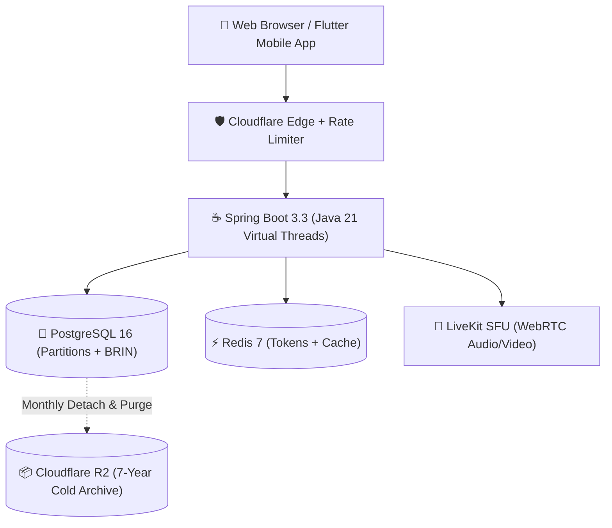

import Tabs from '@theme/Tabs';
import TabItem from '@theme/TabItem';

# HITHA System Architecture & Technical Documentation

Welcome to the **HITHA Healthcare Engineering & Architecture Portal**. This documentation serves as the comprehensive technical reference for the platform's distributed systems, healthcare compliance pipelines, tele-mental-health infrastructure, and recent architectural refactorings.

---

## 🎯 What is HITHA?

<Tabs>
<TabItem value="sinhala" label="📖 සරල සිංහලෙන් (Plain Sinhala)" default>

**HITHA** කියන්නේ ශ්‍රී ලංකාව තුළ මානසික සෞඛ්‍ය උපදේශන (Mental Health Consultations), වීඩියෝ ඇමතුම් (LiveKit Telehealth), ඊ-බෙහෙත් වට්ටෝරු (E-Prescriptions), සහ ආරක්ෂිත ගෙවීම් (PayHere Escrow) එකම තැනකින් ලබාදෙන healthcare platform එකක්.

- **Anonymous / Pseudonymized**: රෝගියාට තමන්ගේ සැබෑ නම හෙළි නොකර, රහස්‍ය නමකින් (Anonymous profile) වෛද්‍යවරයා හමුවිය හැක.
- **On-Demand Consultation**: රෝගියාට බලා නොසිට duty එකේ ඉන්න doctor කෙනෙක්ව විනාඩි 15, 30, හෝ 45 කට ක්ෂණිකව video call එකකට සම්බන්ධ කරගත හැක.
- **High Security & Compliance**: සියලුම දත්ත නීතිමය (PDPA, HIPAA) ප්‍රමිතීන්ට අනුව ගබඩා වන අතර කිසිවෙකුට දත්ත හොරෙන් වෙනස් කළ නොහැක.

</TabItem>
<TabItem value="english" label="💡 Plain English (No Jargon)">

**HITHA** is an enterprise tele-mental-health ecosystem providing secure real-time WebRTC consultations, digital prescription management, on-demand doctor dispatching, and escrow-backed payments.

- **Zero-Trust Identity**: Patients can access care anonymously using verified pseudonyms to eliminate social stigma.
- **On-Demand Emergency Care**: Instant queue dispatcher that pairs distressed patients with available on-duty doctors within seconds.
- **Cryptographic Traceability**: All financial transactions and patient record views are permanently chained with cryptographic SHA-256 hashes to guarantee data immutability.

</TabItem>
<TabItem value="technical" label="⚙️ Deep Architecture & Tech Stack">

The platform is designed around a modern cloud-native service architecture:

- **Backend Runtime**: Spring Boot 3.3.4 running on **Java 21 Virtual Threads** (Project Loom).
- **Relational Persistence**: PostgreSQL 16 with Liquibase migrations, partitioned tables, and Block Range (BRIN) indexing.
- **Distributed In-Memory Engine**: Redis 7 for distributed rate-limiting (Bucket4j token-bucket), presence heartbeat tracking, and cache-aside query acceleration.
- **Real-Time Streaming**: Server-Sent Events (SSE) for domain event broadcasting and LiveKit WebRTC for end-to-end encrypted peer consultation rooms.
- **Observability & Logging**: Dual-Plane Logging model (Logback AsyncAppender for local rolling files, PostgreSQL monthly partitions + Cloudflare R2 WORM cold archival).

</TabItem>
</Tabs>

---

## 🏛️ Core Architectural Pillars

1. **Dual-Plane Logging Model**: High-frequency operational logs are stored in 5GB capped local rolling files, while legally-binding compliance audit logs are stored in PostgreSQL with SHA-256 hash chaining and 7-year Cloudflare R2 archival.
2. **Multi-Tier Distributed Rate Limiting**: Tiered Bucket4j token buckets enforced at the filter level to protect PostgreSQL and HikariCP connection pools from DoS attacks.
3. **Double-Entry Escrow Ledger**: Patient fees remain securely locked in escrow until the doctor marks the consultation session complete.
4. **Sub-10ms Partition Detach**: Database bloat is permanently eliminated by partitioning audit tables monthly and dropping cold partitions after archival to object storage.
