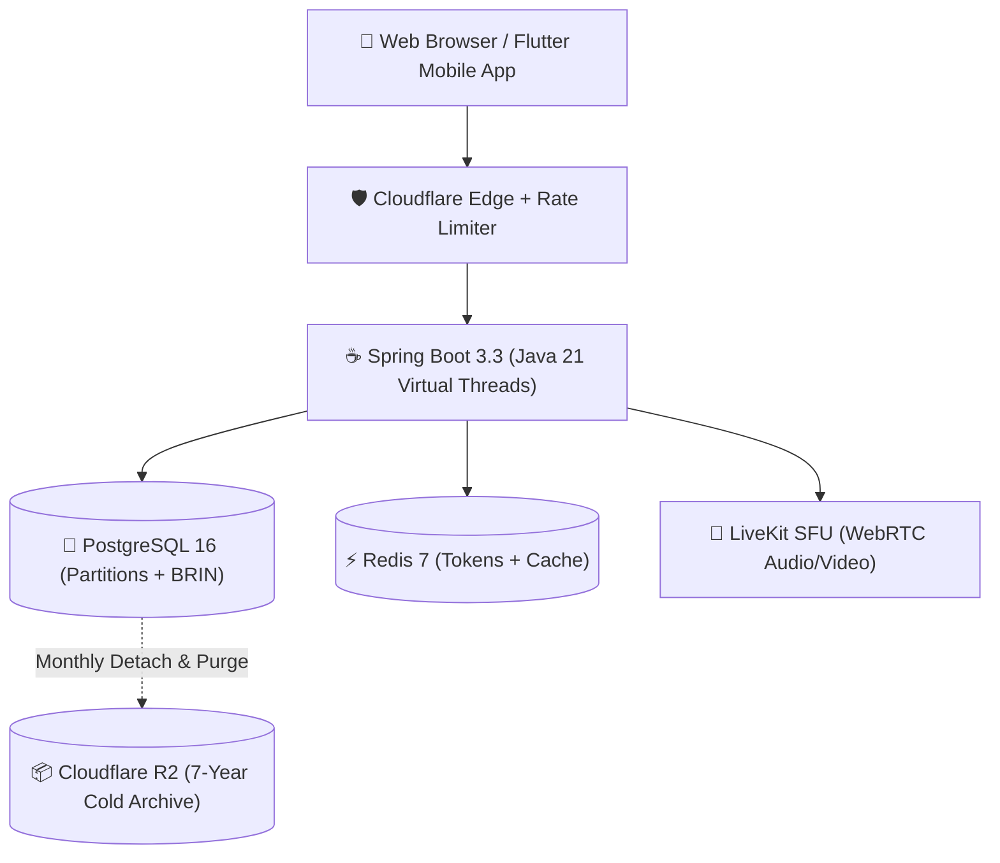

# HITHA System Architecture & Technical Documentation

Welcome to the **HITHA Healthcare Engineering & Architecture Portal**. This documentation serves as the comprehensive technical reference for the platform's distributed systems, healthcare compliance pipelines, tele-mental-health infrastructure, and recent architectural refactorings.

---

## 🎯 What is HITHA?

**HITHA** is an enterprise tele-mental-health ecosystem providing secure real-time WebRTC consultations, digital prescription management, on-demand doctor dispatching, and escrow-backed payments.

- **Zero-Trust Identity**: Patients can access care anonymously using verified pseudonyms to eliminate social stigma.
- **On-Demand Emergency Care**: Instant queue dispatcher that pairs distressed patients with available on-duty doctors within seconds.
- **Cryptographic Traceability**: All financial transactions and patient record views are permanently chained with cryptographic SHA-256 hashes to guarantee data immutability.

---

## 🏛️ Core Architectural Pillars

1. **Dual-Plane Logging Model**: High-frequency operational logs are stored in 5GB capped local rolling files, while legally-binding compliance audit logs are stored in PostgreSQL with SHA-256 hash chaining and 7-year Cloudflare R2 archival.
2. **Multi-Tier Distributed Rate Limiting**: Tiered Bucket4j token buckets enforced at the filter level to protect PostgreSQL and HikariCP connection pools from DoS attacks.
3. **Double-Entry Escrow Ledger**: Patient fees remain securely locked in escrow until the doctor marks the consultation session complete.
4. **Sub-10ms Partition Detach**: Database bloat is permanently eliminated by partitioning audit tables monthly and dropping cold partitions after archival to object storage.
